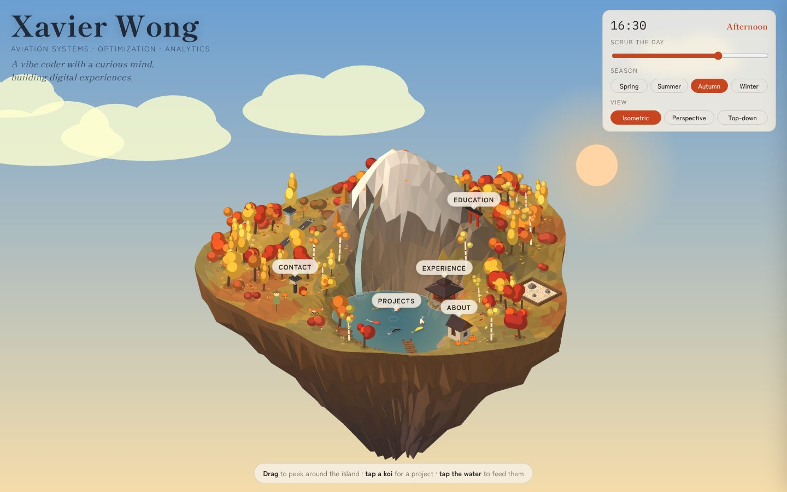
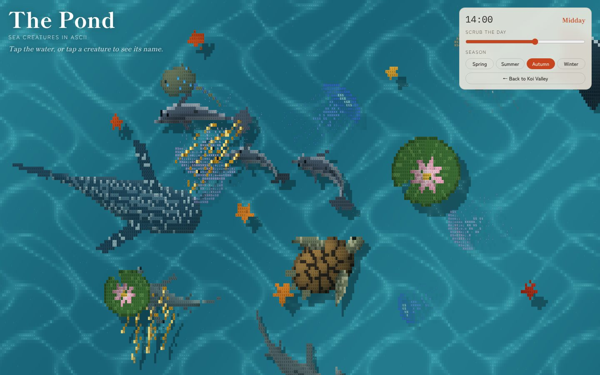

# Koi Valley — Xavier Wong's portfolio

An explorable isometric island that holds my portfolio. A mountain with a waterfall, a koi pond, autumn trees, a small runway and a few wandering foxes float in the sky, and each landmark opens a part of the site.

**Live:** [xavierwongzh.vercel.app](https://xavierwongzh.vercel.app/) · **The Pond:** [/pond](https://xavierwongzh.vercel.app/pond) · **Classic site:** [/old](https://xavierwongzh.vercel.app/old)



## What's on the island

| Landmark | Opens |
| --- | --- |
| The cabin | About |
| The pavilion | Experience |
| The torii on the mountain | Education |
| The lantern | Contact |
| The koi pond | Projects (every koi is a project) |
| The little pond by my desk | [The Pond](#the-pond), a side page |

Tap a landmark or a koi to open its card. On a phone the card slides up from the bottom: swipe down to close it, and on a project page swipe right to go back to the list. Tap the mountain or empty ground to zoom back out.

Project pages have banners, features and outcomes, and some carry more: the DUBY capstone has a click-to-play video and its conference poster. The About and Contact cards link to my resume (PDF).

There are some small things to find as well. The plane on runway 03 takes off when you tap it, the foxes hop when you poke them, tapping the water feeds the koi, and I'm coding at a desk behind the mountain. After dark the animals curl up and sleep, and a tap wakes a fox.

## It follows the visitor's real world

- **Time of day:** the sky, sun, moon and lights follow the visitor's local clock. It's bright at midday, warm at golden hour and lit by lanterns and fireflies at night. The "Scrub the day" slider is endless: drag past either end and the day keeps rolling. About 50 seconds after you let go, it eases back to the live time.
- **Seasons:** the season comes from the visitor's month and hemisphere, so a visitor in Sydney in October sees spring while Singapore and London see autumn. The Season buttons switch it by hand, and `?season=winter` (or `spring`, `summer`, `autumn`) in the URL sets it directly.
- **Weather:** spring brings rain that rings the pond. In winter the pond freezes, snow falls in spells and settles on the ice for a while before it fades.
- **Light:** the trees are clouds of small leaves shaded by the sun's position. Around sunrise and dusk the snowy peak blushes pink with alpenglow.
- **Views:** there are three views, isometric, perspective and top-down. Drag to turn the island, and pinch or scroll to zoom. To pan, use two fingers on a phone, or middle-drag or Shift+drag with a mouse. After you let go, the island waits 5 seconds and then eases back to its home angle.

## The Pond



[The Pond](https://xavierwongzh.vercel.app/pond) is a fun side page: a pond seen from above, with every creature drawn in shaded ASCII characters. A whale shark, two hammerheads, a stingray, a manta, a sea turtle, a pod of dolphins, jellyfish that glow softly at night and schools of golden sardines swim between lotus pads. Tap the water to make a ripple, or tap a creature to see its name.

It shares Koi Valley's clock and seasons. The "Scrub the day" slider works the same way and drifts back to the live time after you let go. In winter the pond is iced over and a tap cracks it (the crack heals), autumn drops maple leaves and spring brings rain. Entering from the island carries over a hand-picked season or a scrubbed hour (`/pond?season=winter&hour=21`), so both places look the same; otherwise the URL is just `/pond`. `/aquarium` redirects here.

## Running it locally

You need Node.js 18.17 or newer.

```bash
git clone https://github.com/xavierwongzh/website.git
cd website
npm install
npm run dev        # http://localhost:3000
```

`npm run build` makes a production build, `npm start` serves it and `npm run lint` runs ESLint. Every push to a branch gets a Vercel preview, and merging to `main` deploys the live site.

## How it's built

The site is a Next.js 15 (App Router) app. Koi Valley, The Pond and the classic site are kept apart with route groups, so each one has its own root layout and styles.

```
app/
├── (koi)/                 # "/" — Koi Valley
│   ├── layout.tsx         # fonts, metadata, Vercel Analytics
│   ├── page.tsx           # renders the shell, the hidden text version and JSON-LD, and loads the scene script
│   ├── markup.ts          # static HTML shell (name, time panel, drawer)
│   └── koi.css            # all Koi Valley styles
├── (aquarium)/            # "/pond" — The Pond
│   ├── layout.tsx         # fonts, metadata, Vercel Analytics
│   ├── pond/page.tsx      # canvas, title and the time and season panel
│   └── aquarium.css
├── (classic)/             # "/old" — the previous site, unchanged
│   ├── layout.tsx
│   ├── globals.css        # Tailwind
│   └── old/page.tsx
├── icon.svg, apple-icon.png   # koi tab icon
└── robots.ts, sitemap.ts
public/
├── koi-valley/
│   ├── koi.js             # the whole scene: terrain, sky, koi, foxes, plane, panels and their content
│   ├── banners/           # project banner images
│   ├── posters/           # the DUBY capstone poster and its thumbnail
│   └── Xavier-Wong-Resume.pdf
├── aquarium/aquarium.js   # the whole Pond: creatures, water, seasons and the day scrubber
└── og.png                 # share image for link previews
lib/
├── koiContent.ts          # lifts the card text out of koi.js at build time
└── siteMetadata.ts        # site URL, title and description
components/, hooks/        # classic site only
next.config.ts             # /aquarium → /pond redirect
```

The island is drawn on a single `<canvas>` with plain JavaScript. It has no 3D library: a low-poly heightfield is projected by hand and painted back to front. All the panel content (About, Experience, Education, Contact and the project detail pages) lives at the top of `public/koi-valley/koi.js`, so that's the place to edit text, add a project or swap a banner.

The cards only appear when someone taps a landmark, so at build time `lib/koiContent.ts` reads the same `PROJECTS` and `PLACES` out of `koi.js` and renders them as visually hidden HTML on the page, with JSON-LD for search engines. Screen readers and search engines get the full text without a second copy to keep in sync.

The Pond works the same way: `public/aquarium/aquarium.js` paints every frame on one canvas, sampling each creature's shape and lighting per character cell and picking a glyph by brightness.

## Contact

[xavierwongzh@gmail.com](mailto:xavierwongzh@gmail.com) · [LinkedIn](https://www.linkedin.com/in/xavierwongzh) · [GitHub](https://github.com/xavierwongzh)

© Xavier Wong
